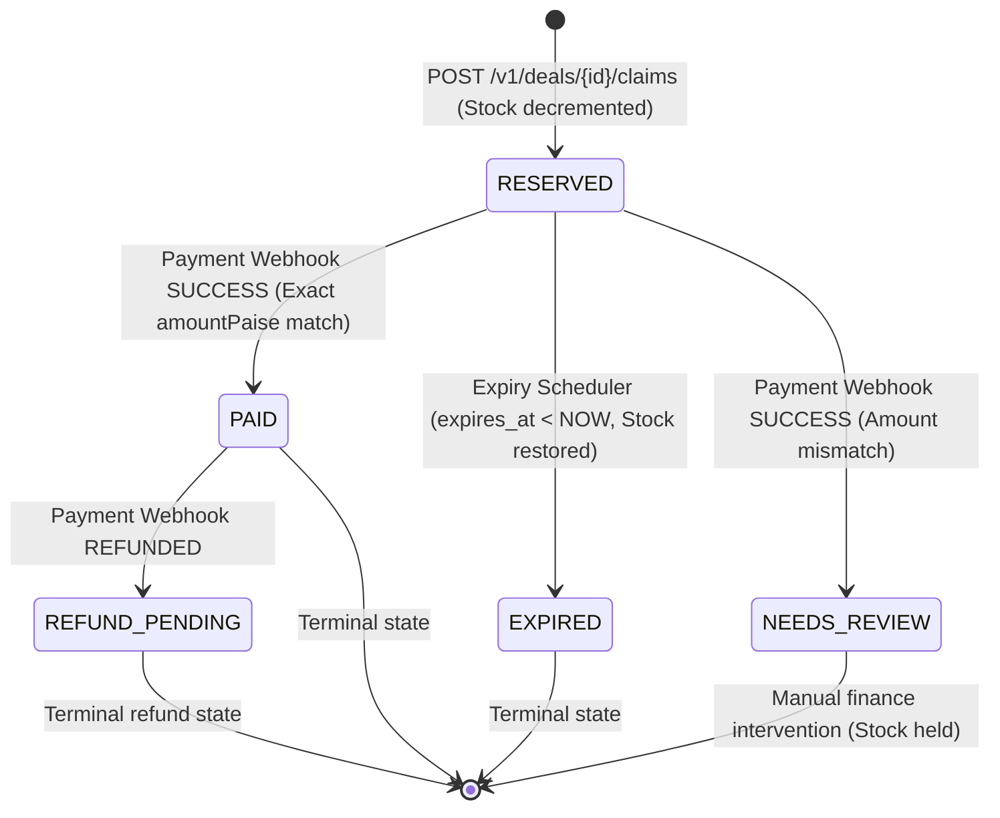

# Nnomm Flash-Deal Claim Service — System Design & Architecture

## 1. System Overview & Problem Statement

During high-profile flash sales, thousands of users compete for limited inventory within milliseconds. The core technical challenges addressed by this system include:
1. **Zero Overselling**: Guaranteeing that total claimed units never exceed available inventory under extreme concurrency.
2. **One Active Claim Per Customer Per Deal**: Preventing a single customer from reserving multiple allotments simultaneously.
3. **Strict Idempotency & In-Flight Protection**: Ensuring network retries replay identical responses while rejecting concurrent duplicate submissions.
4. **Crash Recovery**: Safely recovering from server crashes during transaction processing without leaving orphaned locks or lost requests.
5. **Distributed Inventory Expiry Without Contention**: Expiring unpaid reservations across multiple independent service instances without double-restoring stock or encountering database deadlocks.
6. **Payment Webhook Security & Out-of-Order Handling**: Verifying HMAC-SHA256 signatures, deduplicating events, validating amounts in integer paise, and handling race conditions between payment webhooks and expiration sweeps.

---

## 2. Claim State Machine

Every claim moves through a deterministic, strictly guarded lifecycle:



### State Definitions
- **`RESERVED`**: Stock has been decremented from the deal. Customer has `CLAIM_TTL_SECONDS` (default: 600s) to submit payment.
- **`PAID`**: Valid payment received with matching amount. Claim is finalized and cannot be expired.
- **`EXPIRED`**: Reservation window lapsed before payment. Quantity was atomically returned to `stock_available`. Late payments are rejected.
- **`NEEDS_REVIEW`**: Payment webhook reported success, but the received `amount_paise` differed from the claim's calculated `amount_paise`. Inventory remains safely reserved while finance investigates.
- **`REFUND_PENDING`**: Payment gateway notified refund for an already paid claim. Customer is unblocked to claim again.

---

## 3. Concurrency Control & Stock Safety

### Pessimistic Row Locking vs. Optimistic Locking
In a flash-deal scenario, hundreds of requests hit a single deal record simultaneously:
- **Optimistic Locking (Version columns)**: Causes massive abort-and-retry storms where 99% of concurrent transactions fail on commit, saturating the database and wasting CPU cycles.
- **Pessimistic Locking (`SELECT ... FOR UPDATE`)**: Transactions line up sequentially on the specific deal row. Each transaction reads the latest committed `stock_available`, decrements the quantity, and commits in sub-millisecond time.

```sql
SELECT * FROM deals WHERE id = :dealId FOR UPDATE;
```
Once locked:
1. Check `stock_available >= requested_quantity`.
2. Check `starts_at <= now <= ends_at`.
3. Decrement `stock_available = stock_available - requested_quantity`.
4. Insert `Claim` record with status `RESERVED`.
5. Insert/Update `IdempotencyRecord` with status `COMPLETED`.

---

## 4. Distributed Background Expiry & Deadlock-Free Batching

### Multi-Instance Coordination via `SKIP LOCKED`
When multiple application instances (`app-1` and `app-2`) run concurrently, running background schedulers on each node could lead to duplicate inventory restoration or lock contention.

To solve this, the expiry process queries PostgreSQL using **`FOR UPDATE SKIP LOCKED`**:
```sql
SELECT * FROM claims
WHERE status = 'RESERVED' AND expires_at < NOW()
ORDER BY expires_at ASC
LIMIT :limit
FOR UPDATE SKIP LOCKED;
```
- Instance 1 selects and locks a batch of overdue claims.
- Instance 2 queries at the exact same instant, skips the rows already locked by Instance 1, and locks the next batch.
- Neither instance waits on the other, eliminating lock contention.

### Deadlock Elimination via Deterministic Sorting
When a batch contains claims from multiple deals, multiple threads locking deals in arbitrary order could create deadlocks (e.g., Thread A locks Deal 1 then wants Deal 2, while Thread B locks Deal 2 then wants Deal 1).

**The Solution:**
```kotlin
// Group restored quantities by deal
val quantityByDeal = batch.groupBy({ it.dealId }, { it.quantity })
    .mapValues { (_, quantities) -> quantities.sum() }

// Sort deal IDs deterministically before acquiring row locks
val sortedDealIds = quantityByDeal.keys.sorted()

for (dealId in sortedDealIds) {
    val restoreQty = quantityByDeal[dealId]!!
    val deal = dealRepository.findByIdForUpdate(dealId).orElseThrow()
    deal.stockAvailable += restoreQty
    dealRepository.save(deal)
}
```
Because deal rows are locked in strict alphabetical UUID order, cyclic wait conditions are mathematically impossible.

---

## 5. Robust Idempotency & Crash Recovery Architecture

The `idempotency_records` table manages duplicate detection and crash safety:

```sql
CREATE TABLE idempotency_records (
    id UUID PRIMARY KEY,
    key VARCHAR(255) NOT NULL,
    customer_id VARCHAR(255) NOT NULL,
    deal_id UUID NOT NULL,
    quantity INT NOT NULL,
    status VARCHAR(50) NOT NULL,        -- 'IN_PROGRESS' or 'COMPLETED'
    http_status INT,
    response_body TEXT,
    claim_id UUID,
    locked_at TIMESTAMP WITH TIME ZONE NOT NULL,
    recovery_deadline TIMESTAMP WITH TIME ZONE NOT NULL,
    created_at TIMESTAMP WITH TIME ZONE NOT NULL,
    updated_at TIMESTAMP WITH TIME ZONE NOT NULL,
    CONSTRAINT uq_idempotency_customer_key UNIQUE (customer_id, key)
);
```

### Flow & Edge Cases:
1. **Identical Replay**: If `status == COMPLETED`, deserialize `response_body` and return `201 Created` immediately without touching stock.
2. **Payload Conflict**: If `(deal_id, quantity)` does not match the previous attempt, throw `409 IDEMPOTENCY_KEY_REUSED`.
3. **In-Flight Concurrency**: If `status == IN_PROGRESS` and `recovery_deadline > NOW()`, throw `409 REQUEST_IN_PROGRESS`.
4. **Crash Recovery**: If the node crashed mid-transaction, `status` remains `IN_PROGRESS` but `recovery_deadline` expires. A subsequent retry takes over the lease, resets the deadline, and re-executes the claim cleanly without leaking resources.

---

## 6. Payment Webhook Security & Race Handling

### HMAC-SHA256 Signature Verification
Every webhook request is authenticated using a secret shared with the payment gateway:
- Gateway generates hex digest of `HMAC-SHA256(secret, raw_payload)`.
- Service recomputes the HMAC over the raw request byte stream and performs constant-time equality check via `MessageDigest.isEqual()` to prevent timing attacks.

### Payment vs. Expiry Race Condition
Consider the edge case where an expiry sweep and a payment webhook execute at the exact same millisecond for the same claim:
1. Both operations require a row lock on the claim:
   - Expiry uses `SELECT ... FOR UPDATE SKIP LOCKED`.
   - Webhook uses `claimRepository.findByIdForUpdate(claimId)`.
2. **If Webhook wins the lock first**:
   - Status changes `RESERVED -> PAID`.
   - Expiry sees status is no longer `RESERVED` and skips it. Stock remains decremented.
3. **If Expiry wins the lock first**:
   - Status changes `RESERVED -> EXPIRED`. Stock is restored.
   - Webhook acquires lock, discovers status is `EXPIRED`, rejects transition with `400 INVALID_STATE_TRANSITION`, and leaves stock intact.

Under all execution interleavings, the system maintains strict inventory and state consistency.

---

## 7. Database Partial Indexing Strategy

```sql
-- Enforces one active claim per customer per deal at database level
CREATE UNIQUE INDEX idx_claims_active_per_customer_deal
ON claims (deal_id, customer_id)
WHERE status IN ('RESERVED', 'PAID');

-- Fast index for background expiry batch polling
CREATE INDEX idx_claims_expiry_poll
ON claims (status, expires_at)
WHERE status = 'RESERVED';

-- Fast lookup for customer idempotency keys
CREATE INDEX idx_idempotency_customer_key
ON idempotency_records (customer_id, key);
```

The partial index `idx_claims_active_per_customer_deal` guarantees that even if two requests bypass application validation simultaneously, PostgreSQL will reject the second insert with a unique constraint violation.

---

## 8. Financial Precision: Integer Paise

All currency values (`price_paise`, `amount_paise`) are represented as standard 64-bit integers (`Long` / PostgreSQL `BIGINT`).

Example:
- Item price: ₹2,999.00 -> `299900` paise.
- Quantity 2 -> `299900 * 2 = 599800` paise.
- Floating-point representations (`Double`, `Float`) are strictly prohibited to avoid IEEE 754 rounding errors.
