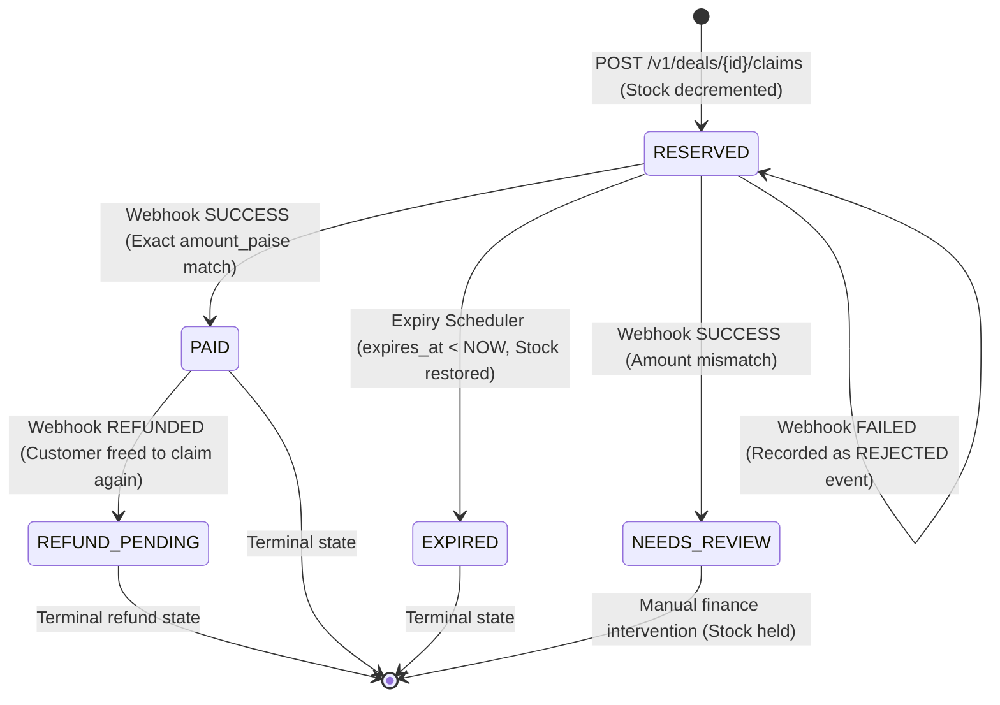

# 🛒 Nnomm Flash-Deal Claim Service

[](https://kotlinlang.org)
[](https://spring.io/projects/spring-boot)
[](https://www.postgresql.org)
[](https://junit.org)
[](https://www.docker.com)

---

## 🚀 Project Overview

The **Nnomm Flash-Deal Claim Service** is a production-grade, high-concurrency flash sale reservation and payment reconciliation backend built with **Kotlin 1.9**, **Spring Boot 3.3.4**, **PostgreSQL 16**, and **Flyway**.

During high-velocity flash sales, thousands of shoppers compete for limited stock allotments within seconds. This service solves the core distributed systems challenges inherent in flash deals:
- **Zero Overselling**: Absolute inventory safety under extreme thread contention using pessimistic row-level locking (`SELECT ... FOR UPDATE`).
- **Strict Idempotency & Crash Recovery**: Replays previous responses on retries, prevents concurrent in-flight duplication, and recovers safely after system crashes using lease deadlines.
- **HMAC-SHA256 Payment Reconciliation**: Cryptographically verified payment webhooks with deduplication, exact integer paise amount matching, and state machine validation.
- **Distributed Expiry & Inventory Recovery**: Periodic batch expiration of unpurchased claims across clustered nodes using `FOR UPDATE SKIP LOCKED` and deterministic lock ordering to guarantee zero deadlocks.
- **Customer Isolation & JWT Security**: Stateless HMAC-SHA256 signed JWT Bearer tokens enforcing strict ownership checks so customers can only access their own reservations.

---

## 🎯 Features

- **Pessimistic Inventory Locking**: Eliminates optimistic lock abort storms and guarantees stock bounds (`0 <= stock_available <= stock_total`).
- **One Active Claim Per Customer Per Deal**: Enforced via application logic and backed by a PostgreSQL partial unique index (`idx_claims_active_customer_deal WHERE status IN ('RESERVED', 'PAID', 'NEEDS_REVIEW')`).
- **Strict Idempotency Semantics**:
  - Replays identical `ClaimResponse` for completed requests.
  - Rejects parameter tampering on existing keys (`409 IDEMPOTENCY_KEY_REUSED`).
  - Blocks concurrent duplicate requests (`409 REQUEST_IN_PROGRESS`).
  - Lease timeout recovery deadline (60s) allowing safe recovery if a node dies mid-transaction.
- **Financial Precision in Integer Paise**: All monetary fields (`price_paise`, `amount_paise`) are stored as 64-bit integers (`Long` / `BIGINT`), eliminating IEEE 754 floating-point inaccuracies.
- **Payment State Machine**: Handles `SUCCESS`, `REFUNDED`, `FAILED`, and amount mismatches (`NEEDS_REVIEW`).
- **Distributed Multi-Instance Safety**: Validated two-instance setup running against a shared PostgreSQL database where background workers coordinate seamlessly via `SKIP LOCKED`.
- **Pre-Seeded Active Deals**: Automatically seeds live sample deals on startup for immediate testing and verification.

---

## 🏗️ Architecture

```
                                  +-----------------------+
                                  |    API Clients /      |
                                  |  Payment Gateway Webhook  |
                                  +-----------+-----------+
                                              |
                       +----------------------+----------------------+
                       | HTTP (Port 8080)                            | HTTP (Port 8081)
                       v                                             v
        +-----------------------------+               +-----------------------------+
        |   App Instance 1 (app-1)    |               |   App Instance 2 (app-2)    |
        | - ClaimController           |               | - ClaimController           |
        | - DealController            |               | - DealController            |
        | - PaymentWebhookController  |               | - PaymentWebhookController  |
        | - ClaimExpiryScheduler      |               | - ClaimExpiryScheduler      |
        |   (FOR UPDATE SKIP LOCKED)  |               |   (FOR UPDATE SKIP LOCKED)  |
        +--------------+--------------+               +--------------+--------------+
                       |                                             |
                       +----------------------+----------------------+
                                              |
                                              v (JDBC Connection Pool)
                               +-----------------------------+
                               |     PostgreSQL 16 Cluster   |
                               | - deals (FOR UPDATE)        |
                               | - claims (Partial Index)    |
                               | - idempotency_records       |
                               | - payment_events (Audited)  |
                               +-----------------------------+
```

### Technology Stack
| Layer | Technology | Details |
|---|---|---|
| **Language** | Kotlin 1.9.25 | JVM 17 target, strict null-safety, `-Xjsr305=strict` |
| **Framework** | Spring Boot 3.3.4 | Web, Data JPA, Security, Actuator, Validation |
| **Database** | PostgreSQL 16.x | ACID transactions, pessimistic locking, partial indexing |
| **Migrations** | Flyway 10.x | Versioned SQL DDL migrations (`V1`, `V2`, `V3`) |
| **Security** | Spring Security + HMAC | Stateless HMAC-SHA256 signed JWT Bearer tokens |
| **Build Tool** | Gradle 8.x | Kotlin DSL (`build.gradle.kts`) |
| **Testing** | JUnit 5 + Zonky Embedded Postgres | 41 integration/concurrency tests against real PostgreSQL 16 |
| **Orchestration** | Docker & Docker Compose | Multi-stage Dockerfile + Two-instance cluster configuration |

---

## 🔌 API Endpoints

All error responses strictly follow the standardized envelope:
```json
{
  "code": "ERROR_CODE",
  "error": "ERROR_CODE",
  "message": "Human-readable explanation of error",
  "timestamp": "2026-10-19T05:00:00Z"
}
```

### 1. Health Check
- **`GET /health`**
  - **Auth**: None
  - **Response `200 OK`**:
    ```json
    { "status": "UP" }
    ```

---

### 2. Deal Endpoints

#### List Active Deals
- **`GET /v1/deals`**
  - **Auth**: None
  - **Response `200 OK`**:
    ```json
    [
      {
        "id": "11111111-1111-1111-1111-111111111111",
        "title": "Wireless Noise-Canceling Headphones",
        "description": "Premium wireless headphones with active noise cancellation",
        "pricePaise": 299900,
        "stockTotal": 50,
        "stockAvailable": 50,
        "startsAt": "2026-10-18T00:00:00Z",
        "endsAt": "2026-11-18T00:00:00Z",
        "createdAt": "2026-10-19T00:00:00Z",
        "updatedAt": "2026-10-19T00:00:00Z"
      }
    ]
    ```

#### Get Deal by ID
- **`GET /v1/deals/{dealId}`**
  - **Auth**: None
  - **Response `200 OK`**: Single `DealResponse` object.
  - **Error `404 Not Found`**: `DEAL_NOT_FOUND`

---

### 3. Claim Endpoints

#### Claim a Flash Deal
- **`POST /v1/deals/{dealId}/claims`**
  - **Headers**:
    - `Authorization: Bearer <jwt_token>` (Required)
    - `Idempotency-Key: <key>` (Required: 1-255 characters matching `^[a-zA-Z0-9_.-]+$`)
  - **Request Body**:
    ```json
    {
      "quantity": 2
    }
    ```
    *(Quantity must be between 1 and 3 inclusive)*
  - **Response `201 Created`**:
    ```json
    {
      "id": "a2444b0e-61df-4b45-913a-5d414a38e079",
      "dealId": "11111111-1111-1111-1111-111111111111",
      "customerId": "cust_12345",
      "quantity": 2,
      "amountPaise": 599800,
      "status": "RESERVED",
      "expiresAt": "2026-10-19T05:10:00Z",
      "createdAt": "2026-10-19T05:00:00Z",
      "updatedAt": "2026-10-19T05:00:00Z"
    }
    ```
  - **Status Codes & Errors**:
    - `201 Created`: Successfully reserved.
    - `400 Bad Request`: `INVALID_QUANTITY`, `INVALID_IDEMPOTENCY_KEY`, `DEAL_NOT_LIVE`, `MALFORMED_JSON`
    - `401 Unauthorized`: `UNAUTHORIZED` (Missing or invalid token)
    - `404 Not Found`: `DEAL_NOT_FOUND`
    - `409 Conflict`: `SOLD_OUT`, `ACTIVE_CLAIM_EXISTS`, `IDEMPOTENCY_KEY_REUSED`, `REQUEST_IN_PROGRESS`

#### Get Claim by ID
- **`GET /v1/claims/{claimId}`**
  - **Headers**: `Authorization: Bearer <jwt_token>` (Required)
  - **Response `200 OK`**: Single `ClaimResponse` object.
  - **Errors**:
    - `401 Unauthorized`: Missing or invalid token.
    - `403 Forbidden`: `FORBIDDEN` (Customer is not authorized to view another customer's claim).
    - `404 Not Found`: `CLAIM_NOT_FOUND`

#### List Customer Claims
- **`GET /v1/claims`**
  - **Headers**: `Authorization: Bearer <jwt_token>` (Required)
  - **Response `200 OK`**: Array of `ClaimResponse` objects belonging exclusively to the authenticated customer.

---

### 4. Payment Webhook Endpoint

#### Process Payment Webhook
- **`POST /v1/payments/webhook`**
  - **Headers**:
    - `X-Signature: <hex_digest>` (Required: HMAC-SHA256 signature over raw request body using `WEBHOOK_SECRET`)
  - **Request Body** *(Supports `snake_case` and `camelCase`)*:
    ```json
    {
      "event_id": "evt_99887766",
      "claim_id": "a2444b0e-61df-4b45-913a-5d414a38e079",
      "amount_paise": 599800,
      "status": "SUCCESS"
    }
    ```
  - **Response `200 OK`**:
    ```json
    {
      "eventId": "evt_99887766",
      "claimId": "a2444b0e-61df-4b45-913a-5d414a38e079",
      "status": "PAID",
      "message": "Payment processed successfully"
    }
    ```
  - **Errors**:
    - `401 Unauthorized`: `UNAUTHORIZED` (Invalid or missing `X-Signature` header).
    - `404 Not Found`: `CLAIM_NOT_FOUND`
    - `409 Conflict`: `INVALID_CLAIM_STATE` (Attempting payment on already `PAID` or `EXPIRED` claim).

---

## 🔐 Authentication & Security

1. **HMAC-SHA256 JWT Authentication**:
   - Stateless JWT tokens signed with a 256-bit+ secret key (`JWT_SECRET`).
   - Validates expiration (`exp`) and extracts customer ID (`sub` or `customerId`).
   - Constant-time signature comparison using `MessageDigest.isEqual` to prevent timing attacks.
2. **Customer Isolation**:
   - `GET /v1/claims/{claimId}` asserts `claim.customerId == token.customerId`. Accessing another customer's claim immediately returns `403 FORBIDDEN`.
3. **Webhook HMAC Validation**:
   - Payment webhooks compute `HMAC-SHA256(rawBytes, WEBHOOK_SECRET)`.
   - Supports both raw hex digest and `sha256=` prefixed headers with constant-time equality check.

---

## 💳 Payment Webhook & State Machine



### Transition Invariants
- **`RESERVED -> PAID`**: Payment success with exact integer paise match. Stock remains securely decremented.
- **`RESERVED -> NEEDS_REVIEW`**: Amount mismatch (`received != expected`). Stock is safely held to prevent inventory loss while finance manually inspects the discrepancy.
- **`PAID -> REFUND_PENDING`**: Payment gateway notifies refund. The claim moves to `REFUND_PENDING`, allowing the customer to participate in the flash deal again.
- **`FAILED Webhook`**: Event is logged in `payment_events` with status `REJECTED`. The claim remains in `RESERVED` so the user can retry before expiration.
- **Terminal Protection**: Late payments arriving on `EXPIRED` or already `PAID` claims are rejected with `409 INVALID_CLAIM_STATE`.

---

## ⚡ Concurrency & Stock Safety

### 1. Zero Overselling via Pessimistic Row Locking
Optimistic locking (`@Version`) causes excessive abort-and-retry storms during flash-sale spikes. This service uses PostgreSQL row-level locks:
```sql
SELECT * FROM deals WHERE id = :dealId FOR UPDATE;
```
Transactions line up sequentially on the specific deal row. Each transaction reads the committed `stock_available`, verifies `stock_available >= quantity`, decrements the stock, and commits in sub-millisecond time.

### 2. At-Most-One Active Claim Guarantee
To prevent a single customer from gaming the system, active claims are constrained at the database level:
```sql
CREATE UNIQUE INDEX idx_claims_active_customer_deal ON claims (deal_id, customer_id)
WHERE status IN ('RESERVED', 'PAID', 'NEEDS_REVIEW');
```
Even under extreme concurrent racing threads, PostgreSQL guarantees that only one transaction succeeds; the other is rejected with a unique constraint violation translated to `409 ACTIVE_CLAIM_EXISTS`.

### 3. Idempotency With Crash Recovery
The `idempotency_records` table tracks customer keys with a lease:
- Replaying the identical key re-emits the cached `ClaimResponse` with `201 Created` without touching inventory.
- Concurrent requests with the same key encounter an active in-flight lease and receive `409 REQUEST_IN_PROGRESS`.
- If an instance crashes mid-execution, the lease expires after `recovery_deadline` (60s), permitting a safe retry without resource leaks.

---

## ⏳ Claim Expiry & Recovery

1. **Non-Blocking Distributed Sweeping**:
   Overdue reservations are queried using `FOR UPDATE SKIP LOCKED`:
   ```sql
   SELECT * FROM claims
   WHERE status = 'RESERVED' AND expires_at < NOW()
   ORDER BY expires_at ASC
   LIMIT :limit
   FOR UPDATE SKIP LOCKED;
   ```
   Multiple nodes running expiry schedulers skip rows already locked by peer nodes, completely preventing lock contention.
2. **Deadlock Elimination via Sorted Deal Ordering**:
   Restoring inventory across multiple deals could cause cyclic deadlocks if threads lock deals in differing orders. The batch processor aggregates quantities by `deal_id` and acquires locks in **strict alphabetical order**:
   ```kotlin
   val sortedDealIds = quantityByDeal.keys.sorted()
   for (dealId in sortedDealIds) {
       val deal = dealRepository.findByIdForUpdate(dealId).orElseThrow()
       deal.stockAvailable += quantityByDeal[dealId]!!
       dealRepository.save(deal)
   }
   ```
3. **Restart Recovery**:
   Any reservations that expired while the service was stopped or restarting are swept and restored immediately on the first post-startup cycle.

---

## 🐳 Docker / Multi-Instance Setup

The included `docker-compose.yml` configures a distributed two-instance cluster connected to a shared PostgreSQL database:
- **`postgres`**: PostgreSQL 16 on port `5432` with healthcheck and persistent volume `postgres_data`.
- **`app-1`**: Instance 1 running on port `8080`.
- **`app-2`**: Instance 2 running on port `8081`.

Both instances run background expiry workers simultaneously against the shared database to demonstrate lock safety.

```bash
# Start the two-instance stack
docker compose up --build -d

# Verify container status
docker compose ps

# Inspect logs across both instances
docker compose logs -f
```

### Healthcheck Verification
```bash
# Verify Instance 1
curl -i http://localhost:8080/health

# Verify Instance 2
curl -i http://localhost:8081/health
```

---

## 🗄️ Database & Flyway Migrations

The database schema is managed via Flyway versioned migrations:
- **`V1__initial_schema.sql`**: Initial table baseline.
- **`V2__exact_nnomm_schema.sql`**: Production DDL establishing:
  - `deals`: Positive price check, stock bounds check, time window check.
  - `claims`: Quantity range 1-3 check, positive paise check, status domain check.
  - `idempotency_records`: Unique `(customer_id, key)` constraint, recovery deadline index.
  - `payment_events`: Audited webhook log with unique `event_id`.
  - Partial unique index `idx_claims_active_customer_deal`.
- **`V3__seed_sample_deals.sql`**: Seeds live sample flash deals:
  - `11111111-1111-1111-1111-111111111111` — Wireless Headphones (₹2,999.00 / 299900 paise, 50 stock).
  - `22222222-2222-2222-2222-222222222222` — Mechanical Keyboard (₹4,999.00 / 499900 paise, 30 stock).

---

## 🧪 Testing & Verification

The test suite runs against a real embedded PostgreSQL 16 engine (via Zonky Embedded Postgres) with Flyway migrations automatically applied:

```bash
# Run the complete test suite
./gradlew test --info
```

### Verified Test Results: 41 Tests / 0 Failures

| Test Class | Tests | Status | Core Assertions Verified |
|---|:---:|:---:|---|
| **`AdversarialAndEdgeCaseIntegrationTest`** | 5 | PASSED | Stock race exhaustion, idempotency key reuse rejection, in-flight concurrent conflict, webhook deduplication, late payment rejection on expired claims. |
| **`ClaimExpiryIntegrationTest`** | 7 | PASSED | Overdue claim restoration, non-expired claims untouched, PAID claims never expired, multi-claim stock aggregation, multi-instance `SKIP LOCKED` isolation, payment vs. expiry race, restart recovery. |
| **`ClaimIntegrationTest`** | 8 | PASSED | Stock reservation, idempotent replay, 1-3 quantity validation, single active claim per customer per deal, deal time window validation, sold-out rejection, key syntax validation. |
| **`DealAndClaimApiIntegrationTest`** | 9 | PASSED | Deal discovery, unknown deal 404, authenticated claim lookup, cross-customer 403 Forbidden, unauthenticated 401 Unauthorized, unknown claim 404, PAID/EXPIRED claim lookups, customer claim history list. |
| **`PaymentIntegrationTest`** | 10 | PASSED | Valid payment to PAID, invalid signature 401, unknown claim 404, amount mismatch to NEEDS_REVIEW, duplicate webhook idempotency, concurrent webhook delivery across instances, reject already PAID claim, reject EXPIRED claim, REFUNDED to REFUND_PENDING, FAILED webhook rejection. |
| **`FlashDealApplicationTests`** | 1 | PASSED | Spring Boot context bootstrapping with full JPA and Flyway lifecycle. |
| **`HealthControllerTest`** | 1 | PASSED | `/health` returns `200 {"status":"UP"}`. |
| **TOTAL** | **41** | **ALL PASSED** | **100% Clean Pass against PostgreSQL 16** |

---

## ▶️ Setup & Run Instructions

### Prerequisites
- **JDK 17** or higher
- **Docker & Docker Compose** (or local PostgreSQL 16)

### Option A: Run with Docker Compose (Recommended)
```bash
docker compose up --build -d
```
The services will be available at `http://localhost:8080` (Instance 1) and `http://localhost:8081` (Instance 2).

### Option B: Run Locally with Gradle
1. Start PostgreSQL:
   ```bash
   docker run -d --name flashdeal-db \
     -e POSTGRES_DB=flashdeals \
     -e POSTGRES_USER=postgres \
     -e POSTGRES_PASSWORD=postgres \
     -p 5432:5432 \
     postgres:16-alpine
   ```
2. Run the application:
   ```bash
   # On Linux / macOS:
   ./gradlew bootRun

   # On Windows PowerShell:
   .\gradlew bootRun
   ```

### Option C: Build & Run Production JAR
```bash
# Package production fat JAR
./gradlew bootJar

# Run bootable JAR
java -jar build/libs/flash-deal-claim-service-0.0.1-SNAPSHOT.jar
```

---

## 📁 Project Structure

```text
nnomm-flash-deal-claim-service/
├── src/
│   ├── main/
│   │   ├── kotlin/com/nnomm/flashdeal/
│   │   │   ├── FlashDealApplication.kt         # Application entry point
│   │   │   ├── claims/                         # Claim domain, reservation, and batch expiry
│   │   │   │   ├── Claim.kt                    # JPA entity for reservation
│   │   │   │   ├── ClaimController.kt          # Claim creation and lookup REST endpoints
│   │   │   │   ├── ClaimDtos.kt                # Claim request/response DTOs
│   │   │   │   ├── ClaimExpiryBatchProcessor.kt# Batch expiry with FOR UPDATE SKIP LOCKED
│   │   │   │   ├── ClaimExpiryScheduler.kt     # Background expiry trigger
│   │   │   │   ├── ClaimExpiryService.kt       # Expiry orchestration
│   │   │   │   ├── ClaimRepository.kt          # Pessimistic locking queries
│   │   │   │   ├── ClaimService.kt             # Claim creation, idempotency, and isolation
│   │   │   │   └── ClaimStatus.kt              # RESERVED, PAID, EXPIRED, NEEDS_REVIEW, REFUND_PENDING
│   │   │   ├── deals/                          # Deal discovery catalog
│   │   │   │   ├── Deal.kt                     # JPA entity for flash deals
│   │   │   │   ├── DealController.kt           # Deal listing and detail endpoints
│   │   │   │   ├── DealDtos.kt                 # Deal response DTOs
│   │   │   │   ├── DealRepository.kt           # findByIdForUpdate query
│   │   │   │   └── DealService.kt              # Deal service logic
│   │   │   ├── payments/                       # Payment webhook and reconciliation
│   │   │   │   ├── PaymentDtos.kt              # Webhook request/response DTOs
│   │   │   │   ├── PaymentEvent.kt             # Audited payment event entity
│   │   │   │   ├── PaymentEventRepository.kt   # Event persistence and deduplication
│   │   │   │   ├── PaymentSignatureValidator.kt# HMAC-SHA256 signature verification
│   │   │   │   ├── PaymentWebhookController.kt # Webhook receiver endpoint
│   │   │   │   └── PaymentWebhookService.kt    # State transitions, amounts, refunds
│   │   │   ├── health/
│   │   │   │   └── HealthController.kt         # GET /health endpoint
│   │   │   ├── security/
│   │   │   │   ├── JwtService.kt               # HMAC-SHA256 JWT generation and validation
│   │   │   │   └── SecurityConfig.kt           # Stateless Spring Security filter chain
│   │   │   └── common/
│   │   │       ├── config/AppProperties.kt     # Configuration properties
│   │   │       ├── exception/                  # Domain exceptions and GlobalExceptionHandler
│   │   │       └── idempotency/                # IdempotencyRecord, status, repository
│   │   └── resources/
│   │       ├── application.yml                 # Application configuration
│   │       └── db/migration/
│   │           ├── V1__initial_schema.sql      # Baseline schema
│   │           ├── V2__exact_nnomm_schema.sql  # Production DDL and constraints
│   │           └── V3__seed_sample_deals.sql   # Active sample deals
│   └── test/
│       ├── kotlin/com/nnomm/flashdeal/
│       │   ├── AdversarialAndEdgeCaseIntegrationTest.kt # Concurrency & adversary tests
│       │   ├── DealAndClaimApiIntegrationTest.kt        # Deal & claim API tests
│       │   ├── FlashDealApplicationTests.kt             # Context bootstrap test
│       │   ├── claims/
│       │   │   ├── ClaimExpiryIntegrationTest.kt        # Expiry & restart recovery tests
│       │   │   └── ClaimIntegrationTest.kt              # Reservation & bounds tests
│       │   ├── health/
│       │   │   └── HealthControllerTest.kt              # Health endpoint test
│       │   └── payments/
│       │       └── PaymentIntegrationTest.kt            # Webhook HMAC & state tests
│       └── resources/
│           └── application-test.yml                     # Embedded PostgreSQL test configuration
├── Dockerfile                                           # Multi-stage container build
├── docker-compose.yml                                   # Two-instance cluster configuration
├── build.gradle.kts                                     # Gradle build configuration
├── DESIGN.md                                            # Comprehensive system design document
└── README.md                                            # Project documentation
```

---

## 📖 Design Reference

For in-depth mathematical proofs, state diagrams, database indexing strategies, and concurrency analysis, refer to [`DESIGN.md`](./DESIGN.md).

---

## 👨‍💻 Author

**Nnomm Flash-Deal Engineering Team**  
*Built for extreme concurrency, absolute financial precision, and robust distributed resilience.*
